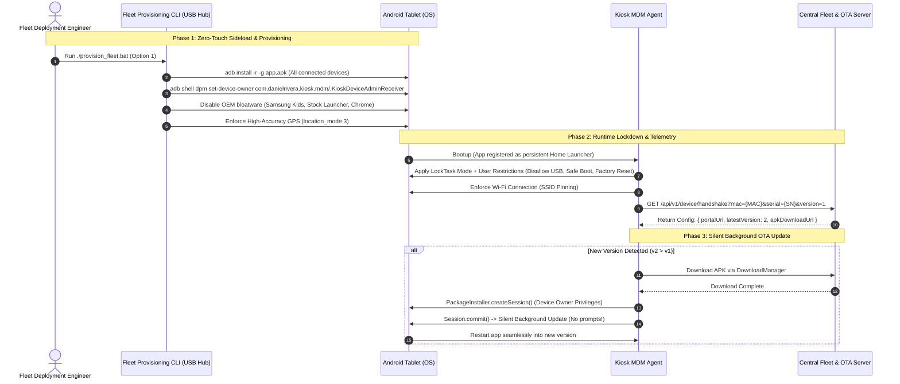

# Android Enterprise Kiosk & MDM Fleet Agent 📱🛡️

[](https://developer.android.com/)
[](https://www.java.com/)
[-0284C7.svg)](https://developer.android.com/work/dpc/dedicated-devices)
[](https://github.com/DanielFRD)
[](https://opensource.org/licenses/MIT)

> **Industrial-grade Android Enterprise Kiosk Launcher & Custom MDM (Mobile Device Management) Agent.**
> Designed, architected, and field-tested across a production deployment of **5,000+ commercial Android tablets** in high-turnover business environments (POS, hospitality, retail, and digital signage).
> 
> Features complete hardware tamper-proofing via **`DevicePolicyManager` (Device Owner)**, automatic **Wi-Fi Pinning**, low-level hardware telemetry, automated multi-tablet ADB provisioning, and **Silent In-App Over-The-Air (OTA) APK Self-Installation** completely independent of Google Play Services.

---

## 🌟 Key Engineering Capabilities

* **COSU (Corporate-Owned Single-Use) LockTask Mode:** Hardware-level lockdown preventing users from exiting to Android Settings, pulling down the notification shade, or pressing physical/software Home, Recents, and Volume buttons.
* **Silent In-App OTA Updates (Zero-Touch):** Automatically compares installed version vs central server manifest; downloads updates via `DownloadManager` and commits silent background installs via `PackageInstaller.Session` without requiring user prompts or Google Play.
* **Wi-Fi Pinning & Self-Healing Enforcer:** Programmatically forces the Wi-Fi radio active and enforces association to an authorized corporate SSID, auto-reconnecting upon signal degradation or network drops.
* **Low-Level Hardware Telemetry via Reflection:** Bypasses modern OEM MAC address randomization blocks using `DevicePolicyManager.getWifiMacAddress()`, and extracts physical serial numbers across Mediatek, Rockchip, Qualcomm, and Allwinner chipsets via reflection on hidden `SystemProperties` (`gsm.sn1`, `ro.serialno`, etc.).
* **Kiosk 24/7 Power Policy:** Enforces `STAY_ON_WHILE_PLUGGED_IN` to guarantee uninterrupted operational availability across power fluctuations and charging docks.
* **Fleet Provisioning Automation:** Interactive ADB toolkit capable of provisioning multiple connected tablets in parallel via USB Hubs in under 30 seconds per device.

---

## 📐 Architecture & Lifecycle



---

## 📂 Repository Structure

```text
android-enterprise-kiosk-mdm/
├── android-app/                       # Native Android Project (Java / Android SDK 21-33)
│   ├── app/src/main/
│   │   ├── AndroidManifest.xml        # Home Launcher & DeviceAdmin Receiver declarations
│   │   ├── java/com/danielrivera/kiosk/mdm/
│   │   │   ├── MainActivity.java      # Immersive Kiosk Controller & Telemetry UI
│   │   │   ├── KioskDeviceAdminReceiver.java # Device Owner Admin entrypoint
│   │   │   └── managers/
│   │   │       ├── KioskPolicyManager.java   # LockTask, Keyguard, UserRestrictions
│   │   │       ├── WifiEnforcerManager.java  # Auto-reconnect & SSID Pinning
│   │   │       ├── SilentUpdateReceiver.java # PackageInstaller session silent install
│   │   │       └── HardwareTelemetry.java    # MAC & Serial resolution via reflection
│   │   └── assets/html/error.html     # Offline Kiosk fallback page
├── fleet-toolkit/                     # Multi-device mass provisioning scripts
│   ├── provision_fleet.bat            # Interactive Windows CLI with parallel USB support
│   └── provision_fleet.sh             # POSIX / Bash equivalent for macOS / Linux
├── mock-ota-server/                   # Micro-service for local testing & live demo
│   ├── server.js                      # Express server with device handshake & live fleet dashboard
│   └── updates/                       # Repository hosting update APKs
└── README.md
```

---

## 🚀 Quick Start Guide

### 1. Launch the Mock OTA & Fleet Server (For Local Testing)

```bash
cd mock-ota-server
npm install
npm run dev
```

* **Live Fleet Monitor:** [http://localhost:5000](http://localhost:5000)
* **Kiosk Portal Preview:** [http://localhost:5000/portal](http://localhost:5000/portal)

---

### 2. Fleet Provisioning via ADB

Connect your Android tablet or emulator with USB Debugging enabled:

#### On Windows:
```cmd
cd fleet-toolkit
provision_fleet.bat
```
Select **`[1] FULL PROVISIONING`** to:
1. Sideload the Kiosk APK to all connected tablets.
2. Grant runtime permissions automatically.
3. Promote the app to **Device Owner** (`dpm set-device-owner`).
4. Debloat consumer apps (disables Samsung Kids, search overlays, and stock launchers).
5. Enforce High-Accuracy GPS mode.

#### On macOS / Linux:
```bash
cd fleet-toolkit
chmod +x provision_fleet.sh
./provision_fleet.sh full
```

---

## 🛠️ Deep Dive: The Silent OTA Update Engine

Standard Android applications cannot install updates without prompting the user with system dialogs. In an enterprise kiosk deployment with 5,000+ unmonitored tablets, requiring a customer or staff member to tap *"Accept and Install"* is unacceptable.

Because this agent runs with **Device Owner** privileges, it bypasses prompt dialogs by committing installation sessions directly to the system `PackageInstaller`:

```java
// PackageInstaller.Session silent commit under Device Owner
PackageInstaller packageInstaller = context.getPackageManager().getPackageInstaller();
PackageInstaller.SessionParams params = new PackageInstaller.SessionParams(
        PackageInstaller.SessionParams.MODE_FULL_INSTALL);
params.setAppPackageName(context.getPackageName());

int sessionId = packageInstaller.createSession(params);
PackageInstaller.Session session = packageInstaller.openSession(sessionId);

// Stream downloaded APK bytes into the installer session
try (InputStream in = new FileInputStream(apkFile);
     OutputStream out = session.openWrite("COSU_OTA", 0, -1)) {
    byte[] buffer = new byte[65536];
    int c;
    while ((c = in.read(buffer)) != -1) {
        out.write(buffer, 0, c);
    }
    session.fsync(out);

    // Commit: Under Device Owner, installation triggers silently in background
    Intent broadcastIntent = new Intent(ACTION_INSTALL_COMPLETE);
    PendingIntent pendingIntent = PendingIntent.getBroadcast(context, sessionId, broadcastIntent, flags);
    session.commit(pendingIntent.getIntentSender());
}
```

---

## 👨‍💻 Author

**Daniel Rivera**
* GitHub: [@DanielFRD](https://github.com/DanielFRD)
* Email: [danielfrd@outlook.com](mailto:danielfrd@outlook.com)
* Focus: Fullstack Systems Engineer • IoT & Hardware Integration • Android Enterprise / MDM Architect

---

## 📄 License
This project is open-source and available under the [MIT License](LICENSE).
